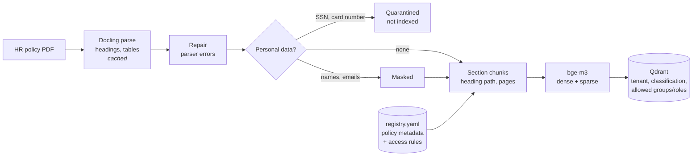
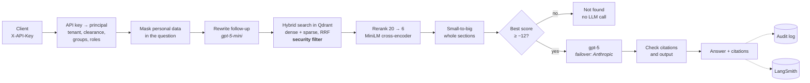

# hybrid-rag

An HR policy assistant built on hybrid retrieval-augmented generation (RAG). Employees ask questions about the company's policies over an API and get short answers that cite the policy, section, page and effective date. Each caller only gets answers from the policies they're allowed to read.

Built with LangChain: Docling parses the PDFs, `bge-m3` produces dense and sparse embeddings, Qdrant fuses dense and keyword search, a cross-encoder reranks, and `gpt-5` writes the answer, with Anthropic as a fallback. FastAPI serves it, with API keys, an audit log and LangSmith tracing.

**On 94 labelled HR questions** ([evaluation](#evaluation-results)):
- The right section is ranked first for **82.6%** of questions (MRR 0.908).
- **85 of 86** answerable questions are answered correctly, with citations.
- **7 of 8** questions the policies don't cover are refused.
- **No restricted chunk** reached a caller without access.

- [Architecture](#architecture)
- [Quick start](#quick-start-docker)
- [Using the API](#using-the-api)
- [How it works](#how-it-works)
- [Evaluation results](#evaluation-results)
- [Design decisions](#design-decisions)
- [Scaling](#scaling)
- [Development](#development)
- [Limitations and roadmap](#limitations-and-roadmap)

## Why hybrid RAG

| Feature | Advanced RAG | Hybrid RAG | Agentic RAG |
|---|---|---|---|
| **Core Mechanism** | Adds pre-retrieval and post-retrieval optimization layers. | Merges dense vector search with sparse keyword or graph search. | Uses autonomous AI agents to plan, route, and loop through tools. |
| **Workflow Style** | Linear pipeline with enhanced processing stages. | Parallel search execution merged via ranking algorithms. | Iterative, non-linear loops with self-correction and tool use. |
| **Latency & Cost** | Moderate latency and compute cost due to reranking. | Low latency (1.5–4s) and low cost ($0.003–$0.015/query). | High, variable latency and higher cost ($0.02–$0.15/query). |
| **Best Use Case** | General accuracy improvements over basic vector search. | Exact terms, SKUs, legal text, or technical identifiers. | Complex multi-hop research, live APIs, and multi-source tasks. |

The latency and cost figures above are typical published ranges, not measurements from this project. Measured here on a laptop CPU: retrieval with reranking takes about 1 s, and a full answer about 7–9 s, almost all of it `gpt-5`. HR policies suit hybrid retrieval: questions mix plain language ("can my partner come on a work trip?") with exact terms (`COBRA`, `HDHP`, `Form I-9`, `Tier 1`).

## Architecture

**Ingestion:** PDF to searchable, permission-tagged chunks.



**A question:** every stage runs with the caller's permissions.



## Quick start (Docker)

**You need:** Docker, about 15 GB of disk, and an OpenAI API key. Nothing else is installed on your machine. Docker needs **more than 2 GB of memory** for indexing (step 2): it doesn't fit in 2 GB, and 8 GB is a safe setting (Docker Desktop: Settings → Resources). Answering questions alone runs in 2 GB. If you can't give Docker more memory, index on your machine instead ([Development](#development)) and use Docker only for the API.

```bash
git clone https://github.com/Aarzoo-Agentic-AI/hybrid-rag.git
cd hybrid-rag
cp .env.example .env        # then set OPENAI_API_KEY in .env
```

**1. Create API keys.** This prints four demo keys, **once**. Copy them now: only their hashes are stored, in `secrets/api_keys.yaml`.

```bash
docker compose run --rm keys --demo
```

The first run builds the image (about 10 minutes).

| Key | Who it stands for | Can read |
|---|---|---|
| `demo-employee` | An employee | The four policies open to all employees |
| `demo-manager` | A people manager | Those, plus the merit and bonus policy |
| `demo-hr-comp` | HR compensation | The same as the manager |
| `demo-admin` | A tenant admin | Everything; can also upload, delete and change access |

**2. Index the five HR policies** in `data/pdfs/`. This runs once, before the API starts, so only one process holds the models in memory:

```bash
docker compose up -d qdrant
docker compose run --rm api python scripts/ingest.py
```

The first time takes 20–30 minutes: it downloads `bge-m3`, the privacy models and Docling's layout models (about 3 GB, kept in Docker volumes), then parses each PDF and embeds each chunk on the CPU. It prints one line per PDF (`added` and its chunk count), then the indexed documents. Running it again skips unchanged files.

**3. Start the API.**

```bash
docker compose up -d
docker compose logs -f api        # wait for "API ready" (about 30 s), then Ctrl+C
```

**4. Ask.** Open **http://localhost:8000/docs**, click **Authorize**, paste the `demo-employee` key and try `POST /query`:

```json
{"question": "What merit increase does a Meets rating get at a 0.95 compa-ratio?"}
```

The employee gets "the policies don't specify…", because the merit policy is restricted. Authorize with the `demo-manager` key and ask again: the answer is "2.5%–3.5% … [1]", citing §6.2 of the merit policy.

**If something goes wrong:**

| Symptom | Fix |
|---|---|
| Every request returns 401 | The API reads the keys at startup: run `docker compose restart api` after creating keys. Send the `hrk_…` key, not the `sha256` from the keys file |
| `docker compose ps` shows `unhealthy` | The API was started before step 2, so it's downloading the models itself, which takes longer than the healthcheck's 5-minute grace period. It recovers once the log says "API ready" |
| The ingest stops with exit code 137, or "Killed" | Docker is out of memory: raise its limit (Docker Desktop: Settings → Resources; with WSL 2, `memory=8GB` in `%UserProfile%\.wslconfig`, then `wsl --shutdown`), or index on your machine with `uv run python scripts/ingest.py`. The API in Docker uses the same Qdrant |
| Every answer is "not found" | Nothing is indexed yet: run step 2. `docker compose exec api python scripts/ingest.py --list` shows what's there |
| `keys` fails with "permission denied" (Linux) | The container runs as user 1000. Run `sudo chown 1000 secrets`, or `docker compose run --rm --user "$(id -u)" keys --demo` |

## Using the API

Every route except `/health` needs an `X-API-Key`. Full details are in the [API README](src/hybrid_rag/api/README.md).

```bash
KEY=hrk_...    # one of the demo keys

# A question
curl -s localhost:8000/query -H "X-API-Key: $KEY" -H "Content-Type: application/json" \
  -d '{"question": "How many PTO days do I get after 4 years?"}'

# With the sources, scores and provider used
curl -s localhost:8000/query -H "X-API-Key: $KEY" -H "Content-Type: application/json" \
  -d '{"question": "What is the hotel cap in Boston?", "debug": true}'

# A follow-up: earlier turns in "history"
curl -s localhost:8000/query -H "X-API-Key: $KEY" -H "Content-Type: application/json" \
  -d '{"question": "And in Chicago?", "history": [
        {"role": "user", "content": "What is the hotel cap in Boston?"},
        {"role": "assistant", "content": "$300 per night including taxes [1]."}]}'

# Streaming (server-sent events: token events, then the final answer)
curl -sN localhost:8000/query -H "X-API-Key: $KEY" -H "Content-Type: application/json" \
  -d '{"question": "Can I fly premium economy to London?", "stream": true}'

# The documents you may read
curl -s localhost:8000/documents -H "X-API-Key: $KEY"
```

A response:

```json
{"request_id": "2d509d83…", "status": "answered", "grounded": true,
 "answer": "20 PTO days per year after 4 years (the 3–5 year band) … [1]",
 "citations": [{"number": 1, "effective_date": "2027-01-01",
                "label": "Employee Benefits Guide §7 Time Off and Leave (Employee_Benefits_Guide_2027.pdf, page 6)"}]}
```

**Admin routes** (the `demo-admin` key):

```bash
ADMIN=hrk_...

# Upload PDFs: returns a job at once; parsing and embedding take a few minutes
curl -s localhost:8000/ingest -H "X-API-Key: $ADMIN" -F "files=@my_policy.pdf"
curl -s localhost:8000/ingest/<job_id> -H "X-API-Key: $ADMIN"

# Change who may read a document: updated in place, nothing re-embedded
curl -s -X PUT localhost:8000/documents/<doc_id>/access -H "X-API-Key: $ADMIN" \
  -H "Content-Type: application/json" \
  -d '{"classification": "confidential", "visibility": "restricted", "allowed_roles": ["people_manager"]}'

# Delete a document and its chunks
curl -s -X DELETE localhost:8000/documents/<doc_id> -H "X-API-Key: $ADMIN"
```

**Your own keys:** each key stands for one principal, and the principal decides what the key can read.

```bash
docker compose run --rm keys alice --clearance internal                       # an employee
docker compose run --rm keys bob --clearance confidential --role people_manager
docker compose run --rm keys ops --admin                                     # a tenant admin
docker compose restart api                                                   # keys are read at startup
```

The options are `--user`, `--tenant`, `--clearance` (`public`, `internal`, `confidential`, `restricted`), `--group` and `--role` (repeat for several) and `--admin`. To disable a key, set `disabled: true` on its entry in `secrets/api_keys.yaml` and restart the API. A lost key can't be recovered, only replaced.

## How it works

Each part has its own README with the details.

- **[Ingestion](src/hybrid_rag/ingestion/README.md):**
  - Docling parses each PDF, keeping headings and tables. The result is cached, so re-indexing doesn't parse again.
  - A repair step fixes known parser errors.
  - Each section becomes a chunk with its heading path and page range, split only when it's long.
  - Policy metadata (name, ID, effective date, jurisdiction, who it applies to) and access rules come from [`data/pdfs/registry.yaml`](data/pdfs/registry.yaml), never guessed from the text.
  - Re-indexing is incremental: unchanged files are skipped, and a change to access rules only updates the stored chunks.
- **[Privacy](src/hybrid_rag/privacy/README.md):**
  - Before chunking, Presidio and pattern rules mask personal data (`<PERSON>`, `<EMAIL>`, …).
  - A document with high-risk data (an SSN, a card number) is quarantined and not indexed.
  - Every chunk is checked again before it's embedded. Questions are masked before they reach the LLM or the traces.
- **[Access control](src/hybrid_rag/store/README.md#access-control):**
  - Every chunk carries its tenant, classification and allowed groups, roles and users.
  - The caller's principal becomes a Qdrant filter on every search, so a chunk the caller may not read is never retrieved and can't leak through the prompt.
  - Access is denied by default. A document the caller can't see answers 404, like a missing one.
- **[Retrieval](src/hybrid_rag/retrieval/README.md):**
  - `bge-m3` dense and sparse vectors are searched together in Qdrant, fused with reciprocal rank fusion (RRF).
  - The MiniLM cross-encoder reranks the best 20 and keeps 6.
  - A hit on part of a long section is expanded to the whole section (small-to-big).
- **[Generation](src/hybrid_rag/generation/README.md):**
  - A LangChain LCEL chain: mask the question, rewrite a follow-up so it stands alone, retrieve, then pick sources within a 3,000-token budget, labelled with their effective dates.
  - A confidence gate skips the LLM when nothing is close.
  - `gpt-5` answers in under 120 words, with `[n]` citations, following the policies' own precedence (the Handbook governs over the Travel and Expense policies). It replies `NOT_FOUND` when the sources don't answer the question.
  - Invalid citations are removed, and the answer gets a privacy check.
- **[LLM failover](src/hybrid_rag/llm/README.md):** `FailoverChatModel` is a LangChain chat model that wraps an ordered list of providers (OpenAI, then Anthropic), with retries, a circuit breaker per provider, and streaming. Any LangChain chain can use it.
- **[API](src/hybrid_rag/api/README.md):**
  - FastAPI, with SHA-256-hashed API keys.
  - Uploads are indexed by a background job.
  - An audit log records each question's caller, status, provider and the chunks used, with the permissions version they were read under. It keeps a hash of the question, not its text.
  - JSON logs carry the request ID.
- **Observability:** each request's `X-Request-ID` appears in the response, the JSON logs, the audit log and the LangSmith trace. [Setting up LangSmith](docs/langsmith.md) is optional.

## Evaluation results

94 labelled HR questions ([eval/golden.yaml](eval/golden.yaml)) are run through each retrieval mode, each asked as an employee, manager or HR-compensation principal. Ranks are per chunk, as sent to the LLM:

| Mode | Recall@1 | Recall@3 | Recall@5 | Recall@10 | MRR | Median latency |
|---|---|---|---|---|---|---|
| `dense` | 77.3% | 94.8% | 98.8% | 98.8% | 0.878 | 0.20 s |
| `sparse` | 50.6% | 70.3% | 77.9% | 86.0% | 0.634 | 0.21 s |
| `hybrid` | 62.8% | 90.7% | 95.9% | 100% | 0.787 | 0.21 s |
| **`hybrid_rerank`** (default) | **82.6%** | **95.3%** | 98.3% | 100% | **0.908** | 0.92 s |

- **The reranker earns its 0.7 s.** It puts the right section first for 82.6% of questions, against 77.3% for dense search alone.
- **Hybrid without reranking is worse than dense.** Sparse search is weak on reworded questions (65.6% Recall@5 on the 45 paraphrased ones, against 91.5% on keyword ones), and fusing it in pulls good dense results down. With the reranker on top, hybrid is the best mode.
- **No leaks:** the 12 questions about the restricted merit policy were also asked by an employee, in every mode. No chunk from that policy came back.

**End to end** (`--answers`, `gpt-5`, `hybrid_rerank`): 85 of 86 answerable questions were answered, cited an expected section and contained every expected figure, and 7 of 8 unanswerable questions were refused. The failures:
- **A sabbatical question:** the right section ranked 7th, just outside the 6 chunks sent to the LLM.
- **"Vacation days in Germany":** the assistant answered with the US PTO table and a caveat, instead of saying the policies are US-only.
- **An employee asking about a raise at the top of the salary range:** nothing restricted was retrieved, but the answer guessed "paid as a lump sum", which happens to be the restricted rule.

**The evaluation changed a setting.** The confidence gate (`answer.min_rerank_score`) was −8.5, calibrated by hand on 23 questions. At that value it refused 9 of the 86 answerable questions, most with the right section ranked first, and stopped no question the LLM wouldn't refuse anyway. It is now −12: a cost floor for questions nothing comes close to, with refusals left to the LLM.

The full results, with per-category tables and every miss, are in [eval/results/](eval/results/). How to run the evaluation and add questions is in the [evaluation README](eval/README.md).

## Design decisions

| Decision | Why | Trade-off |
|---|---|---|
| **`bge-m3` for both dense and sparse vectors** | One model and one pass give both vectors; it's multilingual and handles 8k-token inputs | 2.2 GB, and about 3.7 s per chunk on a laptop CPU, which is why the first ingest takes minutes |
| **Fusion inside Qdrant** (prefetch + RRF) | One round trip, and the security filter is applied to every prefetch as well as the final query | RRF has no tuned weights; on its own, hybrid ranks below dense here |
| **MiniLM reranker by default** | About 1 s per question on a CPU, against about 60 s for `bge-reranker-v2-m3` | English-only; its absolute scores are a poor confidence signal (see the gate below). `bge-reranker-v2-m3` is one config line away on a GPU |
| **Chunks follow sections, with heading paths** | HR answers live in a section or a table row; citations can name the section | Depends on Docling finding the headings; a repair step and per-policy corrections in the registry handle its mistakes |
| **Policy metadata from a registry** | Effective dates, owners and access rules must be right, not inferred from text | Someone has to maintain `registry.yaml` |
| **Permissions enforced in the Qdrant filter, deny by default** | A chunk the caller can't read is never retrieved, so no prompt, citation or bug downstream can leak it | Changing access means a payload update (no re-embedding): an ingest or an API call |
| **404 for documents you can't see** | The answer doesn't reveal that a restricted document exists | 403 would be easier to debug |
| **Mask personal data before chunking; quarantine high-risk files** | Personal data is never embedded, stored or sent to an LLM | A filter removes Presidio's false-positive names (31 on these policies, now 0), so a single-word name ("ask Maria") isn't masked; emails, phones and IDs still are |
| **`FailoverChatModel` as a LangChain chat model** | Every chain gets retries, circuit breakers and failover without knowing about them | Failover to Anthropic is tested with fake models only (no Anthropic key yet) |
| **The confidence gate is a cost floor (−12)** | The evaluation showed a stricter gate refused good questions; `gpt-5` refuses reliably by itself | One LLM call for questions that come close but aren't answered |
| **API keys mapped to principals, stored as hashes** | Simple, and the principal never comes from request fields; a leaked keys file can't be used | No single sign-on yet; replacing keys with OIDC/JWT changes `auth.py` only |
| **Uploads indexed by a background job, one at a time** | A PDF takes minutes on a CPU; requests return at once and uploads don't compete for the CPU | Job status is kept in memory and lost on restart (the indexed documents aren't) |
| **CPU-only Docker image, models in a volume** | 3.9 GB instead of about 7 GB with CUDA; rebuilding the image doesn't download the models again | Slower than a GPU; the first start downloads about 3 GB |

## Scaling

This runs on one machine with a few documents. For a real HR corpus (thousands of policies across many tenants, or millions of documents), this is what would change. More detail is in [FEATURE.md §13](FEATURE.md#13-scaling-to-production).

- **Embedding is the bottleneck.** CPU embedding of tens of millions of chunks takes days. Ingestion would run on GPU workers fed by a durable queue (instead of the in-process job queue), or use a hosted embedding API. Ingestion is already batched and idempotent (content hashes), so it parallelises safely.
- **The reranker on a GPU,** or a hosted reranker. That also makes the stronger `bge-reranker-v2-m3` affordable (about 1 s on a GPU against about 60 s on a laptop CPU).
- **Qdrant at scale:** 10 million `bge-m3` chunks take about 45–50 GB of RAM as raw vectors and HNSW. Scalar quantization brings that to about 10–12 GB, with the originals on disk for rescoring. Beyond that come sharding and replicas across nodes. Tenants already share one collection, through an `is_tenant` payload index, and every filtered field is indexed.
- **Several API workers:** each process loads its own models, and the circuit breakers and job status are per process. Scaling out means a shared store for breaker state and jobs (for example Redis), and an external queue for ingestion.
- **Identity:** OIDC/JWT claims (tenant, groups, roles, clearance) instead of the API-key file.
- **Operations:** monitoring of refusal and failover rates, alerts, Qdrant snapshots and rolling upgrades, or Qdrant Cloud.

## Development

Running locally without Docker needs [uv](https://docs.astral.sh/uv/) and Python 3.12. `uv sync` installs everything, including PyTorch, which comes to several GB.

```bash
uv sync
docker compose up -d qdrant                                   # Qdrant only
uv run python scripts/ingest.py                               # index data/pdfs
uv run python scripts/make_api_key.py --demo                  # writes secrets/api_keys.yaml
uv run uvicorn --factory hybrid_rag.api.app:create_app --port 8000
```

Stop the Docker API first (`docker compose stop api`) if it's using port 8000.

**Without the API:**

```bash
uv run python scripts/search.py "COBRA" --compare                    # all four retrieval modes side by side
uv run python scripts/search.py "merit matrix" --as manager --text   # employee | manager | hr-comp | admin
uv run python scripts/ask.py "How many PTO days do I get after 4 years?"
uv run python scripts/ask.py "What merit increase does a Meets rating get?" --as manager
uv run python eval/evaluate.py                                       # the evaluation (about 5 minutes)
```

**Configuration:**
- [`config.yaml`](config.yaml) holds every pipeline setting, with comments: models, chunking, privacy, retrieval, answer, LLM failover and API.
- `.env` holds secrets only (see [`.env.example`](.env.example)).
- Any setting can be overridden with an environment variable such as `HYBRID_RAG_RETRIEVAL__MODE=dense`.

**Tests:**

```bash
uv run pytest                     # ~400 unit tests: in-memory Qdrant, fake models and LLMs (~3 minutes)
uv run pytest -m integration      # live tests: Qdrant, the real models and the OpenAI API
uv run ruff check . && uv run ruff format --check .
```

The unit tests include a leakage matrix (every caller type × every document type × every read path) and the API end to end.

**Layout:**

```
src/hybrid_rag/
├── ingestion/    Docling parsing, repair, section chunking, policy registry, pipeline
├── privacy/      Presidio and pattern detection, masking, quarantine
├── embedding/    bge-m3 dense + sparse, as LangChain embeddings
├── store/        Qdrant collection, indexing, security filter
├── retrieval/    hybrid retriever, reranker, small-to-big expansion
├── generation/   LCEL answer chain, prompts, sources, citations
├── llm/          provider factory, FailoverChatModel, circuit breaker
├── api/          FastAPI routes, keys, audit log, background jobs
├── evaluation/   golden-set loading, metrics, reports
├── access.py     AccessPolicy and Principal
└── config.py     settings (config.yaml + .env)
scripts/          ingest, search, ask, make_api_key, …
eval/             golden.yaml, evaluate.py, results/
data/pdfs/        the five HR policies and registry.yaml
tests/
```

The design is in [FEATURE.md](FEATURE.md), and the step-by-step build plan with its decisions is in [PLAN.md](PLAN.md).

## Limitations and roadmap

**Known limitations:**
- **Three evaluation failures:** a section ranked just outside the context, a US answer to a question about Germany, and one guess beyond the sources (see [Evaluation results](#evaluation-results)).
- **Answer checks are string matches**, not an LLM judge: strict and repeatable, but they can't judge reasoning or completeness.
- **No runtime evaluation yet:** signals are recorded (status, `grounded`, scores in the audit log and traces), but there's no user feedback or online evaluator.
- **Failover to Anthropic** is tested with fake models only.
- **The data:** all five policies are current and US-only, so filtering by jurisdiction and version is unit-tested but not evaluated. The policies are illustrative samples.
- **Job status is kept in memory;** there's one API worker and no rate limiting.

**Next steps:**
- **Feedback:** a `POST /feedback` route linked to the request ID, sent to LangSmith, with poorly rated questions turned into new golden questions.
- **An online evaluator** for faithfulness on a sample of live traces.
- **Better retrieval:** sending 8 chunks instead of 6, or weighting the RRF fusion; the evaluation can measure both.
- **Agentic retrieval with LangGraph**, letting the model decide whether to search again, and the other later phases in [FEATURE.md §14](FEATURE.md#14-advanced-later-phases).
